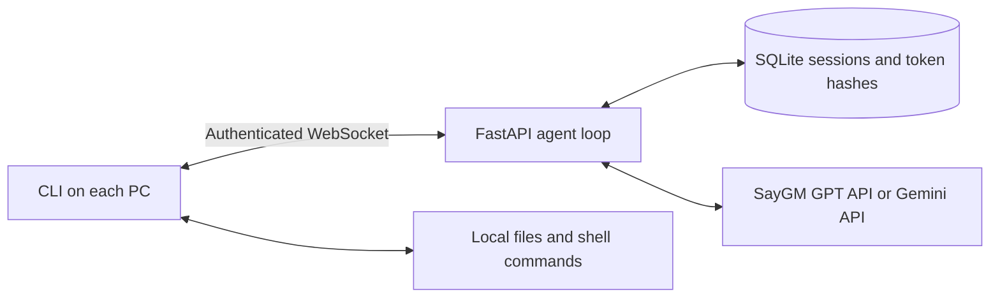

# Agent V

A small Python CLI agent with a shared FastAPI server and local, approval-controlled tools.

**Installing the client? Start with [INSTALL.md](INSTALL.md).** The release installer handles Python
and dependencies; `agent-v setup` saves your connection so you can run `agent-v chat` in any folder.
Server administrators and developers can follow the source setup below. To build a downloadable
client release, see [RELEASING.md](RELEASING.md).



The server holds the model key and manages conversations. The client reads files in a selected
workspace, asks permission for edits and commands, and returns tool results. There is no agent
framework, background job system, or separate database service.

## Download and install

Install [uv](https://docs.astral.sh/uv/getting-started/installation/) on each machine that will
run the server or client. For a source checkout, also install Git. Then run:

```sh
# Replace REPO_URL with this repository's clone URL.
git clone REPO_URL AI_Agent_V
cd AI_Agent_V
uv sync --locked --python 3.13
```

Alternatively, download and extract the repository ZIP, open a terminal in the extracted folder,
and run the same `uv sync` command. uv can download Python 3.13 if it is not installed; the project
supports Python 3.11+. Dependency installation requires internet access.

**Do not copy `.venv` between machines or operating systems.** Download/copy the source and run
`uv sync` on each machine to create its own environment. Keep `.env`, provider keys, and the
server's `.agent-v` database out of copies distributed to client users.

Choose your setup:

- [Local demo](#quick-start-no-api-key-needed): client and server on one machine, no AI key.
- [Local GPT setup](#use-gpt-through-saygm-default): use your SayGM account for real AI responses.
- [Linux VPS + Mac client](#linux-vps-server-and-mac-client-via-ssh): connect through an encrypted
  SSH tunnel without setting up a domain or HTTPS certificate.

## Quick start: no API key needed

Requires Python 3.11+ and [uv](https://docs.astral.sh/uv/getting-started/installation/).
Run these commands from the project directory:

```sh
uv sync --locked
uv run agent-v users add alice
```

Save the printed token. Start the demo server in this terminal:

```sh
uv run agent-v serve --demo
```

In a second terminal, from the project directory:

```sh
export AGENT_V_TOKEN='paste-the-token-here'
uv run agent-v chat --workspace .
```

On PowerShell, set environment variables with `$env:AGENT_V_TOKEN = 'paste-the-token-here'`.

Type a message to check streaming. Type **`demo files`** to exercise a complete local tool round
trip. Demo mode is a deterministic connectivity test, not an AI model; it only echoes text or
requests a directory listing.

## Use GPT through SayGM (default)

Stop the demo server with Ctrl+C. On the **server terminal**, run:

```sh
unset AGENT_V_DEMO
export AGENT_V_PROVIDER=saygm
export AGENT_V_MODEL=gpt-5.4-mini
uv run agent-v serve --ask-api-key
```

Paste your SayGM key into the hidden prompt. It is held in the server process environment only;
it is not saved to disk, sent to Agent V clients, or added to command history by the prompt.
Alternatively, set `GM_API_KEY` in the server environment and run `uv run agent-v serve`.
Use your existing client token in a separate terminal:

```sh
export AGENT_V_TOKEN='your-agent-v-user-token'
uv run agent-v chat --workspace .
```

`GM_API_KEY` authenticates **server → SayGM**. `AGENT_V_TOKEN`, generated by
`agent-v users add`, authenticates **client → server**. They are different credentials.
A model API key cannot be used as a client token. Never paste provider keys into agent chat.
Rotate any key that has been exposed in chat or logs through the SayGM dashboard.

The endpoint is `https://api.saygm.com/v1/chat/completions`. GPT-5.4 mini is the initial default;
change `AGENT_V_MODEL` to another available GPT model with Chat Completions and tool support.
Use a bare model ID, without an `openai/` prefix. See the
[SayGM model catalog](https://api.saygm.com/v1/models?api_shape=chat.completions) and
[quickstart](https://docs.saygm.com/getting-started/quickstart/).

SayGM uses prepaid credit, not an unlimited free API tier. Eligible accounts may receive starter
credit. HTTP **402** means insufficient credit; add credit in your SayGM dashboard before retrying.
HTTP **401** indicates an invalid key; **429** indicates a rate limit. The server shows these errors
without exposing upstream response bodies or keys. It does not automatically retry billable requests.

Start a fresh session after switching providers to avoid carrying provider-specific tool history
between models. Demo mode remains available with `serve --demo` and needs no provider key.

## Optional: use Gemini

On the server, select Gemini explicitly:

```sh
unset AGENT_V_DEMO
export AGENT_V_PROVIDER=gemini
export AGENT_V_MODEL=gemini-3.8-flash
uv run agent-v serve --ask-api-key
```

Enter a key from [Google AI Studio](https://aistudio.google.com/apikey), or set `GEMINI_API_KEY`
and omit `--ask-api-key`. Availability depends on your region and account. See Google's
[pricing](https://ai.google.dev/gemini-api/docs/pricing) and
[rate limits](https://ai.google.dev/gemini-api/docs/rate-limits).

## Try the agent

`--workspace .` selects the terminal's current directory as the agent's working folder. Run `pwd`
to see that directory. To work on another project, pass its path:

```sh
uv run agent-v chat --workspace "/path/to/your/project"
```

The workspace is always on the **client's machine**, even when the server runs on a VPS. File
tools read/search that workspace; approved shell commands start there but are not sandboxed to it.
The directory you run `uv run` from must contain this application's `pyproject.toml`; use an
absolute `--workspace` path for other projects, or install the CLI as described under hosting.

Example prompts:

- “Explain the files in this project.”
- “Find TODO comments and summarize them.”
- “Read README.md and propose a clearer opening paragraph.”
- “Run the test suite and explain any failures.”

An edit displays a unified diff. A command displays the exact shell command. Type `y` or `yes`
to approve; any other answer denies it. Read/search/list tools run without individual approval
inside the selected workspace. Requested contents and tool outputs go to the server and model.

## Everyday commands

```sh
uv run agent-v sessions
uv run agent-v chat --workspace /path/to/project --session SESSION_ID
```

The workspace must match the resumed session. The client shows recent conversation text on resume.
Within chat:

| Command | Action |
| --- | --- |
| `/new` | Start a fresh conversation in the same workspace |
| `/cancel` or Ctrl+C | Cancel the current turn and stop an active local command |
| `/quit` or Ctrl+D | Disconnect and exit |

Cancellation cannot undo completed edits or shell side effects. Interrupted turns are saved with
a note and any received tool results, so the conversation remains resumable. Requests are not
automatically replayed after a lost connection. Reconnect using the printed session ID.

## Linux VPS server and Mac client via SSH

Use this setup to test a remote server without a public HTTP endpoint. You need SSH access to
the VPS, the source installed on both machines using the instructions above, and a SayGM key
with available credit. The examples use `vps-user@VPS_HOST`: replace these with your SSH username
and VPS IP address or hostname. If you normally connect as root, use `root@VPS_HOST`.

### 1. On the VPS: register a client user

SSH into the VPS and open the downloaded project directory. The following assumes you cloned it
into `~/AI_Agent_V`; substitute your actual path if different:

```sh
cd ~/AI_Agent_V
uv sync --locked --python 3.13
export AGENT_V_DB="$PWD/.agent-v/server.sqlite3"
uv run agent-v users add mac-client
```

Copy the printed **Agent V access token** for use on your Mac. This command registers the user in
the VPS database. Creating a user only in your Mac's database will not authorize access to the VPS.
If `mac-client` already exists, use its saved token or choose a different username.

### 2. On the VPS: start the server

In the same VPS terminal:

```sh
unset AGENT_V_DEMO
export AGENT_V_PROVIDER=saygm
export AGENT_V_MODEL=gpt-5.4-mini
uv run agent-v serve --host 127.0.0.1 --port 8000 --ask-api-key
```

Enter your **SayGM API key** at the hidden prompt. Keep this terminal and SSH connection open.
You should see `Uvicorn running on http://127.0.0.1:8000`.

The server listens only on the VPS loopback interface. You do not need to open port 8000 in the
VPS firewall for this setup; the tunnel uses your existing SSH access. For an initial connectivity
test without SayGM credit, use `uv run agent-v serve --demo` instead.

### 3. On your Mac: open the SSH tunnel

Open a separate Mac terminal and run:

```sh
ssh -N -o ExitOnForwardFailure=yes \
  -L 127.0.0.1:18000:127.0.0.1:8000 \
  vps-user@VPS_HOST
```

Authenticate with your normal SSH credentials. If SSH uses a non-default port, add `-p PORT`.
No output after connecting is normal. Leave this terminal open while using the client.

```text
Mac client → Mac localhost:18000 → encrypted SSH connection → VPS localhost:8000
```

Port 18000 on your Mac forwards to port 8000 on the VPS. HTTP is confined to the loopback
connections; traffic between the machines is encrypted by SSH.

### 4. On your Mac: start the client

Open another Mac terminal, go to your local checkout, and run:

```sh
cd ~/AI_Agent_V
export AGENT_V_SERVER='http://127.0.0.1:18000'
export AGENT_V_TOKEN='paste-the-agent-v-token-created-on-the-vps'
uv run agent-v chat --workspace .
```

Use the token from step 1, not the SayGM key from step 2. The client does not need a model API key.
To work on a different local folder, replace `.` with that folder's absolute path.

Try `hello`, then `List the files in this workspace.` In demo mode, use `demo files` instead.
You can also run `uv run agent-v sessions` in this terminal to verify client authentication
without making a model request. It uses the same `AGENT_V_SERVER` and `AGENT_V_TOKEN` settings.

These environment settings apply to the current terminal and its child processes. Set them again
in a fresh terminal. Enter `/quit` to close the client, then Ctrl+C in the tunnel terminal to close
the tunnel. The server remains running while its VPS terminal stays open; this walkthrough runs
it in the foreground, not as an automatically restarted service.

## Send a command from the server to a client

The administrator command feature uses the existing client WebSocket and does not call the AI
model. Starting with version 0.5.0, server commands run automatically by default. There is no background agent,
offline queue, broadcast, or automatic retry. Clients must be connected with `agent-v chat`.

### 1. Enable the feature on the server

Update the server source and run `uv sync --locked`. Generate a separate random admin token:

```sh
uv run python -c 'import secrets; print(secrets.token_urlsafe(32))'
```

Keep the token private. It is different from both the provider API key and ordinary client tokens.
In Bash on the VPS, load it through a hidden prompt, then restart Agent V:

```bash
read -rs -p 'Admin token: ' AGENT_V_ADMIN_TOKEN
printf '\n'
export AGENT_V_ADMIN_TOKEN
uv run agent-v serve --ask-api-key
```

Paste the generated token when prompted. Use `serve --demo` instead if testing without model
access. This feature is disabled when `AGENT_V_ADMIN_TOKEN` is unset, and rejects configured tokens
shorter than 32 characters. Keep using the same database path and provider settings as before.

### 2. Connect the updated client

Install the 0.5.0 client release (see INSTALL.md), or update its source and run `uv sync --locked`.
On the client's PC, run:

```sh
agent-v chat --workspace .
```

From a source checkout, use `uv run agent-v chat --workspace .`.
**Server commands run automatically by default**, without a flag or a per-command approval prompt.
This trusts the connected server administrator to execute shell commands with the client's OS
permissions. Startup announces automatic mode, and each command and its result remain visible.
AI-requested commands and edits still require approval. OS-level access restrictions remain in effect.

To explicitly request server-command approval prompts for one connection, use
`agent-v chat --ask-server-commands`. The previous `--allow-server-commands` flag still works but
is no longer necessary. This behavior also works with a 0.3.0 server; the wire protocol is unchanged.
Clients older than 0.3.0 cannot receive administrator commands.

### 3. List clients and send a command

In another **server terminal**, from the project directory, load the same admin token:

```bash
read -rs -p 'Admin token: ' AGENT_V_ADMIN_TOKEN
printf '\n'
export AGENT_V_ADMIN_TOKEN
uv run agent-v clients --server http://127.0.0.1:8000
```

The list shows each client's ID, username, workspace, and busy/idle state. Select an idle client:

```sh
uv run agent-v send-command CLIENT_ID --server http://127.0.0.1:8000 --command 'echo hello'
```

Replace `CLIENT_ID` with an ID from the list. IDs identify individual live connections and change
on reconnect, so two PCs using the same username can still be targeted separately. Quote commands
to prevent your administrator shell from expanding them before sending them.

On the client, the user sees **“Command requested by the server administrator”**, the exact command,
and execution starts automatically. When launched with `--ask-server-commands`, the client instead
asks for `y` approval; another answer denies the command. The result
is shown on the client and returned to the waiting admin command, including combined stdout/stderr,
exit code, timeout, and truncation status. Commands use the client's shell, so choose syntax that
works on the target OS.

Limits and behavior:

- Busy clients/sessions reject new commands; commands do not interrupt a chat turn.
- The administrator waits up to five minutes including approval. Local execution still has the
  existing 60-second limit and 16 KiB output limit.
- `/cancel`, `/quit`, or a lost connection stops pending work where possible; completed effects
  cannot be undone. If the administrator loses the HTTP response, check the client before retrying.
- Results are returned directly and are not saved into AI conversation history or sent to the model.
- Commands are not sandboxed beyond the user's OS permissions. Server commands execute automatically
  unless the client is launched with `--ask-server-commands`.
- Restarting the server clears the online-client list; clients must reconnect.

Admin API: `GET /admin/clients` and `POST /admin/clients/{id}/command` with JSON
`{"command":"echo hello"}`. Both require `Authorization: Bearer <admin-token>`. Ordinary client tokens
cannot use these endpoints. The POST waits for the result; use the local server URL on the VPS to
avoid reverse-proxy request timeouts. Do not place the admin token in client configuration.

## Troubleshooting

### Linux: `.venv/bin/python` reports “Permission denied”

A virtual environment copied from macOS is not usable on Linux. Preserve the old environment and
create a fresh one **on the VPS**, from the project directory:

```sh
mv .venv ".venv.backup.$(date +%s)"
uv sync --locked --python 3.13
uv run agent-v serve --ask-api-key
```

This leaves source files and the `.agent-v` database in place. If permission errors continue:

```sh
ls -l .venv/bin/python*
findmnt -T "$PWD" -o TARGET,FSTYPE,OPTIONS
```

Check executable permissions and whether the filesystem is mounted with `noexec`. A `noexec`
mount can prevent execution even as root; use a location that permits execution and recreate the
environment there. Changing file permissions alone does not fix a mount restriction or a
virtual environment built for a different operating system.

### Client: “Remote servers require HTTPS”

The client rejects addresses such as `http://VPS_IP:8000` because plain remote HTTP exposes tokens
and file contents in transit. Use the SSH tunnel above and connect to `http://127.0.0.1:18000`, or
configure the HTTPS reverse proxy described below. Merely changing `http` to `https` will not
configure TLS on the server.

### Client: “server rejected WebSocket connection: HTTP 403”

For a direct Agent V connection, this means client authentication failed **before the model was
called**. Check that:

- `AGENT_V_TOKEN` contains the token printed by `agent-v users add`, not your SayGM key or a placeholder.
- That user was created on the server machine, using the same database as the running server.
- The token has not been revoked and was copied without extra spaces.
- The client points to the intended server or tunnel port.

Starting the server does not create users automatically. To add a user while the server is
running, open another VPS terminal, change to the same project directory, set `AGENT_V_DB` to
the same absolute path used when starting the server, and run `uv run agent-v users add NEW_NAME`.
Copy the new token to your client terminal. No server restart is needed.

### Chat: “SayGM credit is exhausted”

Client authentication succeeded, but SayGM returned HTTP 402 for the model request. An API key
identifies an account; it does not provide unlimited free inference. Check available credit in
the SayGM dashboard, add credit if needed, and retry your message. A server restart is generally
unnecessary unless you change the key. If the account already has usable credit, ask SayGM support
about the HTTP 402 response. Do not include your API key in support messages.

### SSH: port already in use, or connection refused

If local port 18000 is already occupied, choose another local port, for example 18001, in both
the SSH `-L` option and `AGENT_V_SERVER`. If SSH reports a forwarding connection refusal, verify
that Agent V is still running on the VPS at `127.0.0.1:8000`. If the client cannot reach local port
18000, check that the tunnel terminal is still connected. No VPS HTTP firewall rule is needed
for an SSH tunnel to the loopback server.

## Multiple users and hosting

On the server machine, issue a different token to each user:

```sh
uv run agent-v users add bob
uv run agent-v users revoke bob
```

Tokens are shown once and stored as SHA-256 hashes. Revoke and re-add the same username to rotate
a token while retaining that user's history. Conversation access is checked against the token's
owner. Admin commands access the local SQLite file; there is no public registration endpoint.

Run one server process on a machine with persistent disk. For a shared endpoint that clients can
use without individual SSH tunnels, put it behind an HTTPS reverse proxy that supports WebSockets
(for example, Caddy). A minimal Caddy configuration is:

```caddyfile
agent.example.com {
    reverse_proxy 127.0.0.1:8000
}
```

Point the domain at your server and configure HTTPS there. On each user's PC:

```sh
export AGENT_V_SERVER='https://agent.example.com'
export AGENT_V_TOKEN='that-users-token'
agent-v chat --workspace /path/to/project
```

The client accepts plain HTTP only for localhost. TLS termination, DNS, and server hosting are
not provisioned by this project. The free model tier does not cover hosting costs.

To distribute the CLI, build a wheel and install it on each PC (with Python 3.11+):

```sh
uv build
uv tool install dist/agent_v-0.5.0-py3-none-any.whl
```

Alternatively, from a source checkout, use `uv tool install .`. The single package includes both
client and server commands; client users need only their server URL and access token.

## Configuration and limits

Environment variables are read directly; `.env.example` is a template, not an auto-loaded file.
Client `setup` saves the address/token in the user profile. For chat, sessions, and doctor, explicit
options override environment variables, which override saved settings. A saved token is never
automatically reused for a different server URL. See INSTALL.md for settings paths and removal.

| Variable | Default | Purpose |
| --- | --- | --- |
| `AGENT_V_PROVIDER` | `saygm` | Server provider: `saygm` or `gemini` |
| `GM_API_KEY` | Required for SayGM unless prompted | Server-only SayGM API key |
| `GEMINI_API_KEY` | Required for Gemini unless prompted | Server-only Gemini API key |
| `AGENT_V_MODEL` | `gpt-5.4-mini` for SayGM; `gemini-3.8-flash` for Gemini | Provider model ID |
| `AGENT_V_DB` | `.agent-v/server.sqlite3` | Server/admin database path |
| `AGENT_V_RPM` | `5` | Shared model requests per minute |
| `AGENT_V_SERVER` | `http://127.0.0.1:8000` | Client server URL |
| `AGENT_V_TOKEN` | Required for clients | User access token |
| `AGENT_V_ADMIN_TOKEN` | Unset (feature disabled) | Separate server/admin-only token for client commands |

Use an absolute `AGENT_V_DB` path when running admin commands from different directories.
All clients share the provider project's quota. A single agent turn can use multiple model
requests. The server rejects excess requests with a retry message and also reports provider
quota failures; it does not silently switch to a paid model.

Limits keep the first version predictable:

- One server process, up to four active turns; one active turn per session.
- Ten model steps per turn, eight tool calls per step, five minutes per turn including approvals.
- Commands: 60 seconds, first 16 KiB of combined output; remaining output is drained and discarded.
- Files: UTF-8 text, up to 64 KiB. Edits require the previous content hash to match.
- Searches: literal text, up to 2,000 files and 40 matches; listings show up to 300 entries.
- Context: roughly 120,000 serialized characters before the next model request; start `/new` when
  full. Automatic summarization is intentionally deferred.

File tools reject traversal, symlinks outside the workspace, hidden paths, common build folders,
and a few common secret filenames. This is a basic filter, not a guarantee of secret detection.
**Approved shell commands are not sandboxed** and run with the client's OS permissions. Inspect
commands before approving them. The selected workspace sets their working directory, not their
access rights. Windows uses its default shell; macOS/Linux use `/bin/sh` semantics.

SQLite stores conversation and tool data in plaintext on the server. Use a trusted server and
protect its disk/backups. Native executables, OAuth, automatic reconnect, secret scanning,
conversation deletion UI, and multi-process scaling are outside this version.

## Development

```sh
uv sync --locked
uv run pytest -q
uv run ruff check src tests
uv run ruff format --check src tests
```

Tests cover authentication, token revocation, session ownership/resume, quota handling,
WebSocket tool results and cancellation, provider stream/signature handling, workspace boundaries,
approval denial, concurrent edit protection, and command limits/termination. Provider tests use
simulated streams; live checks require a provider key and available credit/quota. SayGM tests cover
fragmented streamed tool arguments, credit/authentication errors, cancellation, and key separation.

Code layout:

```text
src/agent_v/
  cli.py          CLI and administrator commands
  client.py       Interactive chat, streaming, and approval prompts
  local_tools.py  Workspace file tools and local command execution
  server.py       Authenticated API and bounded agent loop
  model.py        Shared tool definitions, Gemini adapter, and demo responder
  saygm.py        SayGM GPT streaming and tool-call adapter
  config.py       Server-only provider and credential configuration
  store.py        SQLite sessions and token hashes
tests/            Automated checks
```
